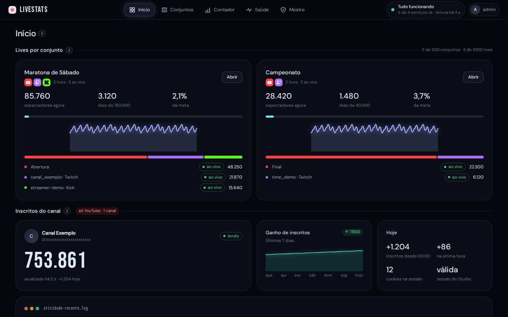
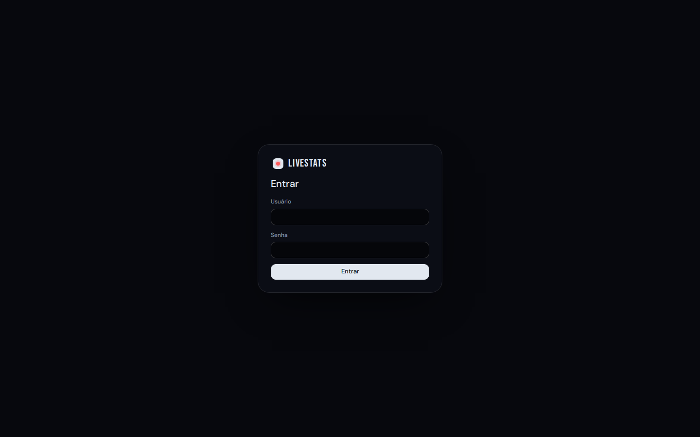
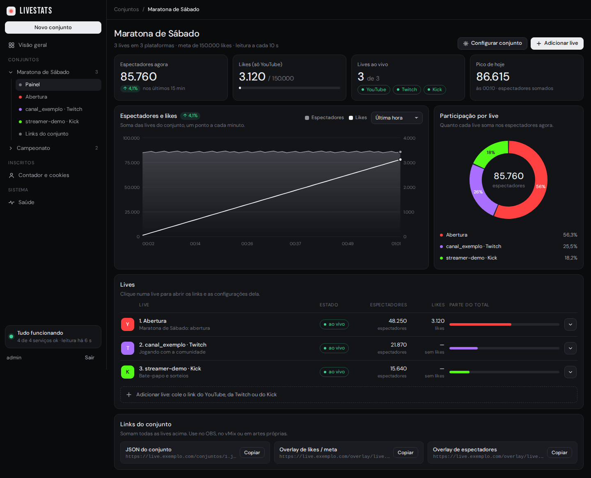
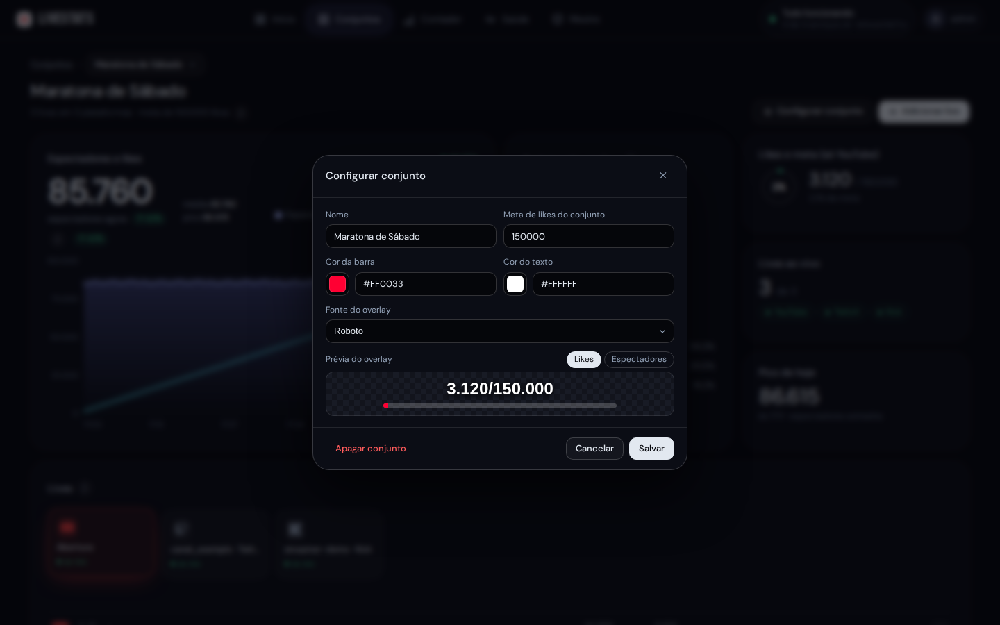
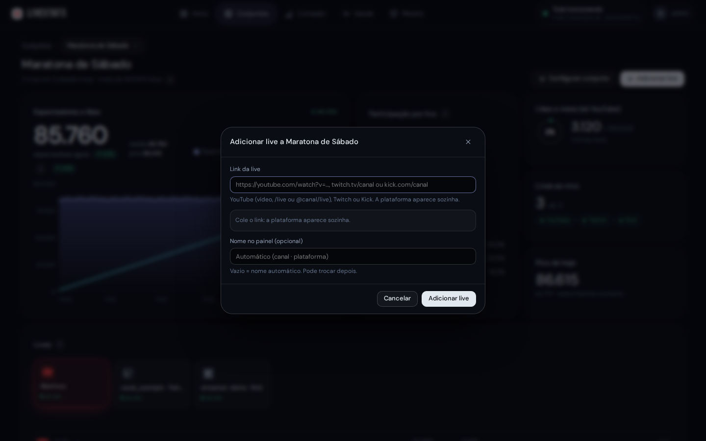
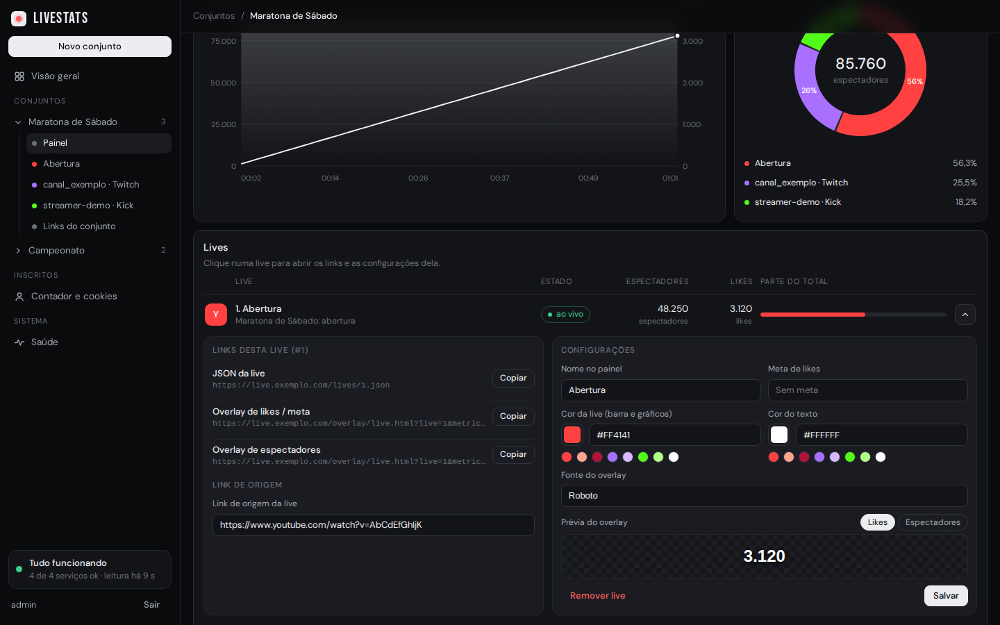
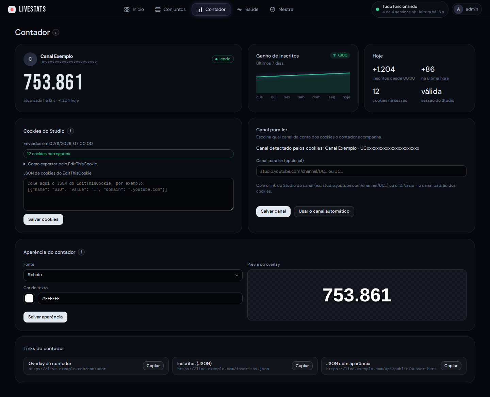
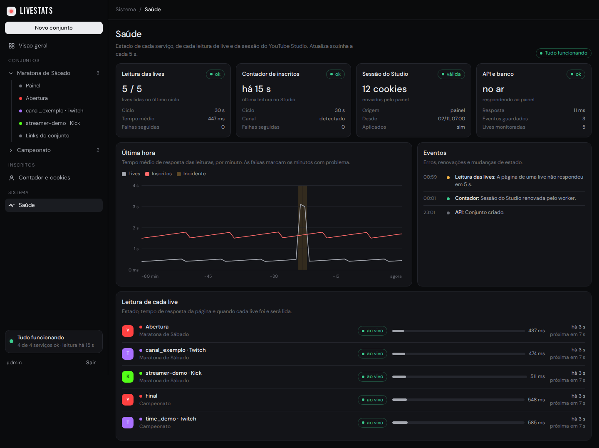
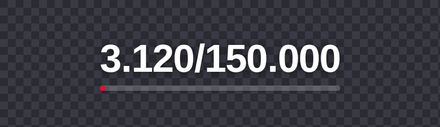

# LiveStats

Estatísticas de lives do **YouTube**, da **Twitch** e do **Kick** reunidas em conjuntos, com JSON e overlays prontos para o **OBS** e o **vMix**, mais um contador de inscritos do canal do YouTube. Tudo é administrado por um painel web protegido por senha e roda em Docker no seu próprio servidor.



- **Conjuntos de lives:** agrupe lives de qualquer plataforma. O LiveStats soma os espectadores, acompanha os likes (YouTube) contra uma meta e guarda o histórico para o gráfico.
- **Sem chave de API:** as lives são lidas das páginas públicas das plataformas, no intervalo que você escolher (de 5 a 15 segundos).
- **JSON e overlays:** cada live e cada conjunto tem um endereço JSON e overlays de likes e de espectadores, com a cor e a fonte que você escolher.
- **Contador de inscritos:** lê o número de inscritos do seu canal no YouTube Studio e entrega em JSON e num overlay animado.
- **Seguro por padrão:** painel só na rede local (ou VPN), HTTPS próprio, senha com hash, cookies do Studio cifrados e containers sem privilégios.

## Sumário

1. [Requisitos](#requisitos)
2. [Instalação](#instalação)
3. [Primeiro acesso](#primeiro-acesso)
4. [Telas do painel](#telas-do-painel)
5. [Usuários e painel mestre](#usuários-e-painel-mestre)
6. [Acessar o painel de fora da rede](#acessar-o-painel-de-fora-da-rede)
7. [Endereços públicos](#endereços-públicos)
8. [Usar no OBS e no vMix](#usar-no-obs-e-no-vmix)
9. [Atualizar, backup e voltar versão](#atualizar-backup-e-voltar-versão)
10. [Problemas comuns](#problemas-comuns)
11. [Segurança](#segurança)

## Requisitos

- **Servidor** com **ZimaOS** ou **Linux** com Docker (versão recente) e o plugin `docker compose` (v2). Reserve pelo menos **5 GB livres** para construir as imagens (o Chromium faz parte delas).
- **Rede:** o servidor precisa de saída HTTPS para `youtube.com`, `twitch.tv` e `kick.com`. As portas **8080** (pública) e **8081** (painel) ficam livres no servidor.
- **Seu computador** com `bash`, `git` e `ssh` (no Windows, use o Git Bash) para rodar o instalador, que envia o código ao servidor por SSH.
- **Opcional:** [Nginx Proxy Manager](https://nginxproxymanager.com/) e [Cloudflare Tunnel](https://developers.cloudflare.com/cloudflare-one/connections/connect-networks/) para publicar os endereços na internet com seu próprio domínio. Dentro da rede local não precisa de nada disso.
- **Para o contador de inscritos:** acesso ao YouTube Studio do canal e uma extensão de navegador que exporte cookies em JSON, como o EditThisCookie.

## Instalação

A instalação é feita do seu computador, com um único comando. Baixe o código e, na pasta dele, rode o instalador:

```sh
git clone https://github.com/victor-newton/LiveStats.git
cd livestats
bash deploy/enviar.sh instalar --host 192.168.0.10 --user meu-usuario-ssh
```

Troque `192.168.0.10` pelo IP do servidor e `meu-usuario-ssh` pelo usuário com que você entra nele por SSH. Se preferir, defina as variáveis `LIVESTATS_HOST` e `LIVESTATS_USER` e omita `--host` e `--user`.

### Passo a passo

1. **Usuário com acesso ao Docker.** O usuário do SSH precisa falar com o Docker. Se o instalador reclamar disso, rode uma vez no servidor `sudo usermod -aG docker SEU-USUARIO` e entre de novo.
2. **(Opcional) Preflight.** `bash deploy/enviar.sh preflight --host IP --user USUARIO` só faz leitura: confere Docker, espaço em disco, portas 8080/8081 livres e se há Nginx Proxy Manager ou cloudflared no servidor. O próprio `instalar` já roda essa checagem antes de mudar qualquer coisa.
3. **Instalar.** Rode o comando acima. Ele pergunta, sem mostrar na tela:
   - a **senha do painel** (mínimo de 8 caracteres, digitada duas vezes). Ela nunca é gravada: o servidor guarda só o hash;
   - a **senha do SSH** do servidor (uma única vez).

   O instalador então cria a pasta `/DATA/AppData/livestats` no servidor, escreve o `.env`, constrói as imagens (a primeira vez leva alguns minutos), gera os segredos (chaves dos cookies, hash da senha e certificado HTTPS autoassinado do painel) e sobe os quatro serviços, esperando todos ficarem saudáveis. No fim ele testa os endereços e mostra o endereço do painel.
4. **Conferir.** `bash deploy/enviar.sh status --host IP --user USUARIO` mostra os serviços e os últimos registros.

Opções do `instalar`:

| Opção | Para quê |
|---|---|
| `--host IP` / `--user NOME` | Servidor e usuário do SSH (obrigatórios, ou use as variáveis `LIVESTATS_HOST` e `LIVESTATS_USER`) |
| `--admin-user NOME` | Usuário do painel (padrão `admin`) |
| `--admin-allow "REDES"` | Quem pode abrir o painel na porta 8081, em IPv4/CIDR separados por espaço (padrão `192.168.0.0/16 100.64.0.0/10`: rede local e Tailscale) |
| `--public-base-url URL` | Endereço público usado nos links que o painel mostra e copia (ex.: `https://live.exemplo.com`) |
| `--admin-externo` | Liga o acesso ao painel de fora da rede (veja [Acessar o painel de fora da rede](#acessar-o-painel-de-fora-da-rede)). Exige `--admin-trusted-proxy` (ou o IP já gravado pelo `conectar-npm`); sem ele o instalador recusa. `--admin-interno` desliga |
| `--admin-trusted-proxy IP` | IP fixo do Nginx Proxy Manager na rede do LiveStats (ex.: `172.29.80.11`) |
| `--public-admin-url URL` | Endereço externo do painel, mostrado na tela Conta (ex.: `https://painel.exemplo.com`) |
| `--master-allow "REDES"` | Só estas redes (IPv4/CIDR) podem entrar como mestre e usar as telas do mestre. Vazio = sem filtro |
| `--extra-san IP` | Inclui outro IP (por exemplo o do Tailscale) no certificado do painel; pode repetir |
| `--conectar-npm [NOME]` | Já liga o Nginx Proxy Manager à rede do LiveStats (veja a opção A abaixo) |
| `--sem-segredos` | Reinstalar ou atualizar sem pedir a senha de novo (os segredos já existem) |
| `--renew-tls` | Gera um certificado novo para o painel |
| `--skip-build` | Não reconstrói as imagens |

Exemplo completo:

```sh
bash deploy/enviar.sh instalar --host 192.168.0.10 --user meu-usuario-ssh \
  --admin-user meu-usuario --public-base-url https://live.exemplo.com
```

### Outros comandos do `enviar.sh`

| Comando | O que faz |
|---|---|
| `instalar` | Instala ou atualiza (veja acima) |
| `registrar-zimaos` | No **ZimaOS**, faz o LiveStats aparecer como cartão na tela inicial. Pede a senha do SSH e a do `sudo`. Rode depois do `instalar` e de cada atualização. `--remover` desfaz |
| `status` | Mostra os serviços, o batimento dos workers e os últimos registros (sem segredos) |
| `preflight` | Checagem do servidor, só leitura |
| `conectar-npm` | Liga o Nginx Proxy Manager à rede do LiveStats (opção A, abaixo) |
| `rollback` | Desliga o LiveStats **sem apagar os dados** (pede para digitar `sim`) |

### Publicar na internet (opcional)

Para usar os endereços fora da sua rede, aponte o Nginx Proxy Manager (que o Cloudflare Tunnel já alcança) para o LiveStats. Há dois jeitos:

- **Opção B, a mais simples:** no Nginx Proxy Manager, crie um *Proxy Host* para o seu domínio com destino `http://IP-DO-SERVIDOR:8080` e SSL habilitado. Não mexe em nada no container do NPM. O limite de requisições por visitante passa a contar o IP do NPM.
- **Opção A:** rode `bash deploy/enviar.sh conectar-npm --host IP --user USUARIO` (ou use `--conectar-npm` no `instalar`). O NPM entra na rede interna do LiveStats com IP fixo, o *Proxy Host* aponta para `livestats-web` na porta `8080` e cada visitante é contado pelo IP real (via `CF-Connecting-IP`). Reinicie o container do NPM uma vez depois de conectá-lo. Se o ZimaOS recriar o container do NPM, rode `conectar-npm` de novo.

Em qualquer das duas, **nunca** publique a porta 8081 (o painel) na internet: ela fica só na rede local ou na VPN.

## Primeiro acesso

1. Abra `https://IP-DO-SERVIDOR:8081` num computador da rede local (ou da VPN).
2. O navegador avisa que o certificado não é confiável: ele é autoassinado e gerado só para o seu servidor. Escolha **Avançado** e continue. Isso é pedido uma vez por navegador.
3. Entre com o usuário do painel e a senha que você digitou na instalação.



Depois do login, crie o primeiro conjunto (botão **Novo conjunto**), adicione as lives e, se for usar o contador, cole os cookies na tela **Contador e cookies**.

## Telas do painel

### Visão geral


Resume tudo de uma vez: um cartão por conjunto (espectadores agora, likes contra a meta, mini gráfico e a lista de lives com o estado de cada uma), o contador de inscritos do canal e a atividade recente. Cada conjunto tem os seus próprios números; nada é somado entre conjuntos. Clique em **Abrir conjunto** para entrar no conjunto.

Na barra lateral ficam os conjuntos (cada um abre um submenu com o painel, as lives e os links), o contador, a **Saúde** e, embaixo, o estado geral dos serviços.

### Conjuntos e lives



Um **conjunto** reúne lives de qualquer plataforma que você quer mostrar juntas, por exemplo todas as transmissões de um mesmo evento. A tela mostra:

- os totais (espectadores agora, likes contra a meta, lives ao vivo e o pico do dia);
- o **gráfico** de espectadores e likes, com período de 5 minutos a 2 horas (passe o mouse para ver os valores de cada minuto);
- a **rosca** com a participação de cada live nos espectadores;
- a lista de **lives** e os **links do conjunto**.

**Novo conjunto** (barra lateral) cria um conjunto. **Configurar conjunto** edita o nome, a meta de likes, a fonte e a cor do texto; **Adicionar live** inclui uma transmissão.





Para adicionar uma live, cole o link do YouTube (vídeo, `/live` ou `@canal/live`), da Twitch (`twitch.tv/canal`) ou do Kick (`kick.com/canal`); a plataforma aparece sozinha. O nome no painel é opcional. Se a transmissão ainda não começou, a live fica como "agendada" ou "offline" e passa a "ao vivo" sozinha.

### Links, cores e prévia de cada live



Clique numa live para abrir os **três links** dela, cada um com o botão **Copiar**:

- **JSON da live:** os dados dela para usar em artes e gráficos;
- **Overlay de likes / meta:** o número de likes (e a barra da meta, se houver);
- **Overlay de espectadores:** o número de espectadores agora.

Ao lado ficam as **configurações**: nome no painel, meta de likes, **cor da live** (usada na barra, no gráfico e na rosca), **cor do texto** e **fonte do overlay**. A **prévia** mostra na hora como o overlay vai ficar, para likes ou espectadores. **Salvar** grava; **Remover live** tira a live do conjunto. O rodapé do conjunto traz os mesmos três links para o conjunto inteiro (soma das lives).

Os links usam o endereço informado em `--public-base-url`. Sem ele, o painel mostra o endereço pelo qual você abriu a página.

### Inscritos, cookies e aparência



A tela **Contador e cookies** controla o contador de inscritos do canal do YouTube:

- o cartão do canal mostra o nome (descoberto sozinho pelos cookies), o número atual, o ganho dos últimos 7 dias e o de hoje;
- em **Cookies do Studio**, cole o JSON exportado do seu navegador (extensão EditThisCookie, logado no YouTube Studio do canal) e clique em **Salvar cookies**. Eles ficam cifrados e só o serviço que lê o contador consegue abri-los; o painel nunca os mostra de volta. Quando a sessão é renovada pelo próprio serviço, o painel avisa. Só YouTube, um canal;
- em **Canal para ler (opcional)**, escolha qual canal da conta o contador acompanha. Por padrão é o canal que o YouTube Studio abre sozinho com os seus cookies; se a conta tem mais de um canal (por exemplo um pessoal e outro da marca), cole o link do Studio do canal desejado (`studio.youtube.com/channel/UC...`) ou só o ID (`UC...`) e clique em **Salvar canal**. O painel mostra o canal que está sendo lido e o selo **canal escolhido**; **Usar o canal automático** volta ao padrão. A conta dos cookies precisa ter acesso ao canal: senão o contador mostra o erro "A conta dos cookies não tem acesso a este canal". Trocar de canal não apaga o histórico do canal anterior. Canais com menos de 10 inscritos ainda não aparecem (o formato público exige 2 dígitos ou mais);
- em **Aparência do contador**, escolha a fonte e a cor do texto, com prévia, e clique em **Salvar aparência**;
- os **links do contador** (overlay `/contador`, JSON de inscritos e JSON com a aparência) ficam no fim da tela, com **Copiar**.

### Saúde



Mostra se está tudo funcionando: o estado de cada serviço (leitura das lives, contador de inscritos, sessão do Studio, API e banco), o tempo de resposta por minuto na última hora (as faixas marcam incidentes), os eventos recentes (erros, renovações de sessão) e a leitura de cada live, com o tempo de resposta e quando será a próxima. Atualiza sozinha.

### No celular

No celular, as abas ficam numa barra fixa embaixo da tela; no computador, no cabeçalho. Todas as telas funcionam no celular, desde que ele esteja na rede local, na VPN ou (com o acesso externo ligado) no endereço do painel.

## Usuários e painel mestre

O painel aceita vários usuários, cada um com seus próprios conjuntos, lives e contador de inscritos. Não existe cadastro aberto: só o **mestre** (o usuário criado na instalação) cria contas.

- **Criar um usuário:** no painel, aba **Mestre › Usuários**, **Novo usuário**. O LiveStats gera uma **senha provisória** de 16 caracteres, mostrada uma única vez (use **Copiar** e envie por um canal seguro). No primeiro acesso a pessoa é obrigada a trocar a senha (mínimo de 8 caracteres).
- **Limites por usuário:** quantidade de conjuntos e de lives e se ele tem contador de inscritos. Existe ainda um teto geral (`MAX_SETS_TOTAL`, padrão 200, e `MAX_LIVES_TOTAL`, padrão 1000, no `.env`).
- **Cada um enxerga só o que é seu.** O mestre vê o uso de cada conta, a atividade recente (entradas, trocas de senha, contas e conjuntos criados ou apagados), pode redefinir a senha, suspender, limpar os dados ou apagar a conta (digitando o nome dela para confirmar) e abrir os dados de qualquer usuário para editar. A tela **Saúde** é só do mestre.
- **Limpar meus dados:** na aba **Conta**, em **Zona de risco**, **Limpar meus dados** apaga os seus conjuntos, lives, contador, cookies e leituras (você digita o seu nome de usuário para confirmar). A conta, a senha e os limites continuam. O mestre pode fazer o mesmo com os próprios dados.
- **Contador por usuário:** cada conta com contador tem os próprios cookies do Studio, aparência e links. O do mestre continua em `/contador`, `/inscritos.json` e `/api/public/subscribers`; o dos outros usuários é lido por id (veja [Endereços públicos](#endereços-públicos)).
- **Restringir o mestre:** com `MASTER_ALLOW_CIDRS` no `.env` (ou `--master-allow` no `instalar`), o login do mestre e as telas do mestre só funcionam a partir dessas redes.

## Acessar o painel de fora da rede

Por padrão o painel só abre na rede local ou na VPN. Para abri-lo de qualquer lugar, em `https://painel.seudominio.com`, use o mesmo Nginx Proxy Manager (NPM) e o mesmo túnel do Cloudflare que já publicam os overlays. O painel continua protegido por HTTPS, senha, token CSRF e limite de tentativas; o que muda é que a lista de IPs deixa de valer.

1. **Ligue o NPM à rede do LiveStats e ligue o acesso externo.** Um comando só (o IP fixo do NPM aqui é um exemplo):

   ```sh
   bash deploy/enviar.sh instalar --host 192.168.0.10 --user meu-usuario-ssh --sem-segredos --skip-build \
     --admin-externo --admin-trusted-proxy 172.29.80.11 --public-admin-url https://painel.seudominio.com --conectar-npm
   ```

   Sem `--admin-trusted-proxy` (ou um IP já gravado por `conectar-npm`) o instalador **recusa** a opção, e o servidor do painel também não sobe: sem saber qual é o proxy, o LiveStats não conhece o IP real de quem entra e o limite de tentativas valeria para todos juntos. Se o ZimaOS recriar o container do NPM, rode `bash deploy/enviar.sh conectar-npm --host IP --user USUARIO` de novo.
2. **Crie o *Proxy Host* no NPM.** O `conectar-npm` imprime estes passos com os seus valores reais:
   - *Domain Names:* `painel.seudominio.com`;
   - *Scheme:* **https**; *Forward Hostname / IP:* **`172.29.80.2`** (o IP fixo do web na rede do LiveStats, variável `WEB_EDGE_IP`; **não use o nome `livestats-web`**: o Nginx do NPM não resolve nomes do Docker e responde 502; também **não use o IP do servidor** (`192.168.x.x`), pois assim a conexão não vem do NPM e o limite de logins vira um só para todos); *Forward Port:* **8081**;
   - o certificado interno do painel é autoassinado e o NPM não o valida, então não há nada a configurar nesse ponto;
   - *Websockets Support:* não é necessário;
   - aba **SSL:** escolha o certificado do domínio (ou emita um com a Let’s Encrypt) e ligue *Force SSL*;
   - cabeçalhos: o NPM já envia `X-Forwarded-For`; não o desligue. O painel só confia no cabeçalho do IP quando a conexão vem do IP fixo do NPM. Pelo túnel do Cloudflare o último salto de `X-Forwarded-For` é só o do túnel; use então `--admin-real-ip-header CF-Connecting-IP` (variável `ADMIN_REAL_IP_HEADER`; aceita `X-Forwarded-For`, o padrão, `CF-Connecting-IP` ou `X-Real-IP`; outro valor impede o painel de subir), para o limite de login e o bloqueio por tentativas valerem por visitante.
3. **Túnel do Cloudflare:** em *Zero Trust › Tunnels*, no mesmo túnel do site, adicione o *Public Hostname* `painel.seudominio.com` com o mesmo serviço do hostname do site (o NPM). Para o limite de login valer por pessoa (e não pelo túnel inteiro), na aba **Advanced** do *Proxy Host* cole `real_ip_header CF-Connecting-IP;` e `set_real_ip_from IP-DO-CLOUDFLARED;` (o `conectar-npm` imprime o IP quando encontra o container).
4. **Confira:** `bash deploy/enviar.sh status --host IP --user USUARIO` mostra se o acesso externo está ligado e avisa se falta o IP do proxy.

Cuidados ao abrir o painel para a internet:

- **Use uma senha forte e única** (8 caracteres no mínimo, mas prefira uma frase longa). É ela que protege o painel agora, não a lista de IPs.
- **Só o mestre cria usuários:** não há cadastro aberto. Dê senhas provisórias por um canal seguro e apague ou suspenda contas que não usa mais.
- **Limite do mestre:** defina `MASTER_ALLOW_CIDRS` (por exemplo só a sua rede e a VPN) para que o login do mestre e as telas do mestre não funcionem de fora, mesmo com o painel aberto.
- O login tem limite de **5 tentativas por minuto por IP**, e o bloqueio por tentativas erradas vale por IP e por usuário.
- Para voltar ao modo só-rede-local: `instalar --admin-interno --sem-segredos --skip-build` (a lista `--admin-allow` volta a valer).

## Endereços públicos

Estes endereços **não pedem login**, podem ser usados direto no OBS, no vMix ou em artes próprias e aceitam leitura de qualquer origem (CORS). Na rede local use `http://IP-DO-SERVIDOR:8080`; na internet, o seu domínio.

| Endereço | O que entrega |
|---|---|
| `/lives/{id}.json` | Dados de uma live (também em `/api/public/lives/{id}`) |
| `/conjuntos/{id}.json` | Dados de um conjunto, com a soma das lives (também em `/api/public/sets/{id}`) |
| `/overlay/live.html?live={id}&metrica=likes` | Overlay de likes e meta de uma live |
| `/overlay/live.html?live={id}&metrica=views` | Overlay de espectadores de uma live |
| `/overlay/live.html?conjunto={id}&metrica=likes` | Overlay de likes e meta do conjunto |
| `/overlay/live.html?conjunto={id}&metrica=views` | Overlay de espectadores do conjunto |
| `/inscritos.json` | Inscritos do canal do mestre (formato fixo, simples de usar) |
| `/api/public/subscribers` | O mesmo, acrescido de `font` e `text_color` do contador |
| `/contador` | Overlay animado do contador de inscritos do mestre |
| `/inscritos/{id}.json` | Inscritos do contador de um usuário (também em `/api/public/subscribers/{id}`); `{id}` é o número do contador, que aparece nos links da tela Contador |
| `/contador?contador={id}` | Overlay animado do contador de um usuário (sem o parâmetro, o do mestre) |
| `/health` | Estado resumido do servidor |

O `{id}` de cada live e conjunto aparece nos links do painel (use o botão **Copiar**).

### Exemplos de JSON

`/lives/1.json`:

```json
{
  "id": 1,
  "set_id": 1,
  "platform": "youtube",
  "label": "Abertura",
  "title": "Maratona de Sábado: abertura",
  "status": "ao_vivo",
  "viewers": 48250,
  "likes": 3120,
  "goal": 150000,
  "progress": 0.0208,
  "color": "#FF4141",
  "font": "Roboto",
  "text_color": "#FFFFFF",
  "updated_at": "2026-11-04T15:20:31Z"
}
```

`/conjuntos/1.json`:

```json
{
  "id": 1,
  "name": "Maratona de Sábado",
  "viewers_total": 85760,
  "likes_total": 3120,
  "goal": 150000,
  "progress": 0.0208,
  "color": "#FF0033",
  "font": "Roboto",
  "text_color": "#FFFFFF",
  "updated_at": "2026-11-04T15:20:31Z",
  "lives": [
    {"id": 1, "platform": "youtube", "label": "Abertura", "status": "ao_vivo", "viewers": 48250, "likes": 3120, "color": "#FF4141", "font": "Roboto", "text_color": "#FFFFFF"},
    {"id": 2, "platform": "twitch", "label": "", "status": "ao_vivo", "viewers": 21870, "likes": null, "color": "#A970FF", "font": "Roboto", "text_color": "#FFFFFF"}
  ]
}
```

`likes` só existe no YouTube (`null` nas outras plataformas) e `progress` é `likes / goal`, limitado a 1 (`null` sem meta).

`/inscritos.json`:

```json
{"inscritos":"753.861","raw":"753.861","atualizado_em":"2026-11-04T15:20:30.654321Z"}
```

Enquanto a primeira leitura não acontece, os endereços respondem `503` com uma mensagem de "dados ainda não disponíveis".

### Como ficam os overlays

Os overlays têm fundo transparente. Nos prints abaixo, o fundo quadriculado é só para mostrar a transparência.

| Likes e meta | Espectadores | Contador |
|---|---|---|
|  |  |  |

## Usar no OBS e no vMix

**Overlays no OBS**

1. Em **Fontes**, clique em **+** e escolha **Navegador**.
2. Em **URL**, cole o link do overlay copiado do painel (por exemplo `http://IP-DO-SERVIDOR:8080/overlay/live.html?conjunto=1&metrica=views`).
3. Ajuste largura e altura (por exemplo 800 x 200). O fundo já é transparente.

**Overlays no vMix**

1. **Add Input**, aba **Web Browser**.
2. Cole o link do overlay e defina a largura e a altura. Use a entrada numa camada (*layer*) sobre o vídeo para o fundo transparente aparecer.

**Dados em artes do vMix (GT Title) e do OBS**

Use `/lives/{id}.json`, `/conjuntos/{id}.json` ou `/inscritos.json` como **Data Source** (no vMix: *Data Sources*, tipo JSON, com atualização a cada poucos segundos). Os nomes dos campos são os do exemplo acima.

Dica: dentro da rede local use o IP e a porta 8080, que não dependem de internet, do túnel nem do domínio.

## Atualizar, backup e voltar versão

**Atualizar.** Baixe a versão nova (`git pull`) e rode de novo no seu computador:

```sh
bash deploy/enviar.sh instalar --host IP --user USUARIO --sem-segredos
```

Isso reconstrói as imagens e recria só o que mudou, mantendo os dados e os segredos. No ZimaOS, termine com `bash deploy/enviar.sh registrar-zimaos --host IP --user USUARIO`. Só o código **commitado** é enviado.

**Backup.** Os dados ficam em dois volumes do Docker, `livestats-data` (conjuntos, lives, histórico, leitura de inscritos e cookies cifrados) e `livestats-admin` (sessões do painel), e os segredos ficam na pasta `secrets/` da instalação (`/DATA/AppData/livestats/secrets`). Para guardar uma cópia, no servidor:

```sh
cd /DATA/AppData/livestats
docker run --rm -v livestats-data:/data:ro -v "$PWD":/backup alpine tar czf /backup/livestats-data.tgz -C /data .
tar czf secrets-backup.tgz secrets
```

Guarde o `secrets-backup.tgz` em lugar protegido: ele tem as chaves dos cookies. Para restaurar, desfaça o `tar` nos mesmos lugares e rode `docker compose up -d`.

**Voltar versão.** Escolha a versão antiga no seu computador (`git checkout NOME-DA-VERSAO`) e rode o `instalar --sem-segredos` de novo. Os dados são mantidos.

**Desligar sem perder nada.** `bash deploy/enviar.sh rollback --host IP --user USUARIO` desliga os serviços e solta o Nginx Proxy Manager da rede do LiveStats, sem apagar os volumes. Antes, no NPM, desative ou aponte para outro destino qualquer *Proxy Host* que use `livestats-web` (um destino que não resolve impede o NPM de recarregar). Para religar: `instalar --sem-segredos`. Só apague os dados se tiver certeza (`docker volume rm livestats-data livestats-admin`).

**Trocar a senha do painel.** No servidor, `sh /DATA/AppData/livestats/deploy/install.sh --lan-ip IP --reset-admin-password --skip-build` (rode por `ssh -t`, pois pergunta no terminal) e depois `docker compose up -d --force-recreate api`.

**Renovar o certificado do painel** (vale 825 dias): `instalar --renew-tls --sem-segredos`.

## Problemas comuns

| Sintoma | O que fazer |
|---|---|
| O preflight diz que não consegue falar com o Docker | O usuário do SSH não está no grupo `docker`. No servidor: `sudo usermod -aG docker USUARIO` e entre de novo |
| "Plugin 'docker compose' (v2) não encontrado" com `permission denied` em `.docker/config.json` | Comum no ZimaOS. Os scripts já contornam; para comandos manuais, use `export DOCKER_CONFIG=$(mktemp -d)` antes do `docker compose` |
| O painel dá **403** na porta 8081 | O IP do seu computador não está em `--admin-allow` (variável `ADMIN_ALLOW_CIDRS` do `.env`). Ajuste e rode `docker compose up -d web` na pasta de instalação |
| O navegador não confia no certificado do painel | É esperado (autoassinado). Aceite uma vez. Se o IP do servidor mudou, rode `instalar --renew-tls --sem-segredos` com o IP novo |
| O `web` não sobe e o registro fala em certificado ou chave | Falta ou há permissão errada em `secrets/admin_tls_*.pem` (devem ser `644`). Rode `instalar --renew-tls --sem-segredos` |
| O contador lê o canal errado (por exemplo o pessoal, e mostra "Contador nao encontrado na pagina") | Em **Contador**, preencha **Canal para ler** com o link do Studio ou o ID do canal certo e salve |
| O contador de inscritos não atualiza e a tela mostra aviso de cookies | A sessão do Studio venceu ou os cookies são de outra conta. Exporte os cookies de novo, logado no canal certo, e cole em **Contador e cookies** |
| A live fica "aguardando" ou "erro" | Confira o link (deve ser da transmissão ao vivo, não do canal) e a tela **Saúde**: ela mostra o motivo e o tempo de resposta. O Kick às vezes exige o navegador interno (`KICK_BROWSER=1`, o padrão) |
| O endereço público dá **502** logo depois de `conectar-npm` | O NPM guardou o DNS de antes de entrar na rede do LiveStats. Reinicie o container do NPM (`docker restart nginxproxymanager`) |
| O endereço público dá **429** com muitos visitantes (opção B) | Todos dividem o limite do IP do NPM. Passe para a opção A |
| O NPM não recarrega depois do `rollback` | Algum *Proxy Host* ainda aponta para `livestats-web`. Desative-o ou mude o destino |
| No ZimaOS o LiveStats funciona mas não aparece na tela inicial | Rode `bash deploy/enviar.sh registrar-zimaos --host IP --user USUARIO` |
| O `instalar` parou dizendo para rodar o `registrar-zimaos` | Com o app registrado no painel do ZimaOS, o código e as imagens são atualizados e a recriação dos containers é feita por esse comando |

Para ver o que está acontecendo: `bash deploy/enviar.sh status --host IP --user USUARIO`.

## Segurança

- O painel só responde na porta 8081, com HTTPS próprio, e só para as redes da lista `--admin-allow`. Nunca publique a porta 8081 diretamente na internet; para acessar de fora use o Nginx Proxy Manager, como descrito em [Acessar o painel de fora da rede](#acessar-o-painel-de-fora-da-rede) (que exige senha forte e um proxy confiável).
- Só o mestre cria contas; cada usuário enxerga apenas os próprios dados, e o login do mestre pode ser restrito a certas redes (`MASTER_ALLOW_CIDRS`).
- A senha do painel nunca é gravada, só o hash (argon2id). O login limita tentativas e protege as ações com token CSRF.
- Os cookies do YouTube Studio são cifrados com uma chave pública; só o serviço do contador tem a chave privada. Trate esses cookies como uma senha da sua conta.
- Os segredos ficam em arquivos na pasta `secrets/` do servidor, montados como Docker secrets só no serviço que precisa, e nunca em variáveis de ambiente nem no Git.
- Os containers rodam sem privilégios (usuário comum, sistema de arquivos somente leitura, sem capacidades extras), e a API não tem acesso à internet.
- Os endereços públicos são somente leitura e têm limite de requisições por visitante.
