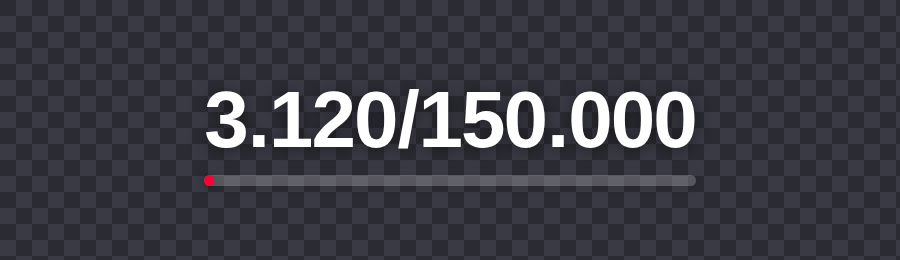
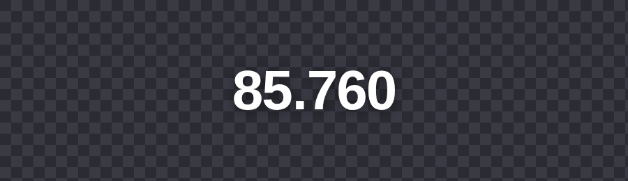
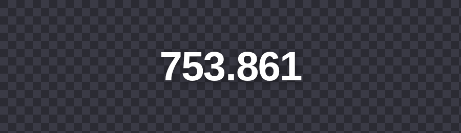

# Endereços públicos

[Início](../README.md) · [Instalação](instalacao.md) · [Primeiros passos](primeiros-passos.md) · [Painel](painel.md) · [Usuários](usuarios.md) · [Acesso externo](acesso-externo.md) · **Endereços públicos** · [OBS e vMix](obs-e-vmix.md) · [Manutenção](manutencao.md) · [Problemas comuns](problemas-comuns.md) · [Segurança](seguranca.md)

Estes endereços **não pedem login**, podem ser usados direto no OBS, no vMix ou em artes próprias e aceitam leitura de qualquer origem (CORS). Na rede local use `http://IP-DO-SERVIDOR:8080`; na internet, o seu domínio.

| Endereço | O que entrega |
|---|---|
| `/lives/{id}.json` | Dados de uma live (também em `/api/public/lives/{id}`) |
| `/conjuntos/{id}.json` | Dados de um conjunto, com a soma das lives (também em `/api/public/sets/{id}`) |
| `/overlay/live.html?live={id}&metrica=likes` | Overlay de likes e meta de uma live |
| `/overlay/live.html?live={id}&metrica=views` | Overlay de espectadores de uma live |
| `/overlay/live.html?conjunto={id}&metrica=likes` | Overlay de likes e meta do conjunto |
| `/overlay/live.html?conjunto={id}&metrica=views` | Overlay de espectadores do conjunto |
| `.../overlay/live.html?...&metrica=views&icone=1` | O mesmo de espectadores, com o ícone da plataforma ao lado do número (no conjunto, os ícones das plataformas ao vivo) |
| `/overlay/live.html?conjunto={id}&metrica=views&plataforma=youtube` | Espectadores só de uma plataforma (`youtube`, `twitch` ou `kick`); aceita `&icone=1`. No painel, o botão **Icone** liga isso no endereço copiado |
| `/overlay/chat.html?conjunto={id}` | Overlay do chat unificado do conjunto (opcional: `&tema=cartoon`, `adesivo`, `pixel`, `postit`, `chiclete`, `classico`, `balao`, `vidro`, `minimal`, `terminal` ou `rodape`) |
| `/api/public/chat/{id}` | Aparência do chat do conjunto (tema, tamanho, ícone, cor do nome); as mensagens não ficam em endereço nenhum |
| `/inscritos.json` | Inscritos do canal do mestre (formato fixo, simples de usar) |
| `/api/public/subscribers` | O mesmo, acrescido de `font` e `text_color` do contador |
| `/contador` | Overlay animado do contador de inscritos do mestre |
| `/inscritos/{id}.json` | Inscritos do contador de um usuário (também em `/api/public/subscribers/{id}`); `{id}` é o número do contador, que aparece nos links da tela Contador |
| `/contador?contador={id}` | Overlay animado do contador de um usuário (sem o parâmetro, o do mestre) |
| `/health` | Estado resumido do servidor |

O `{id}` de cada live e conjunto aparece nos links do painel (use o botão **Copiar**).


## Exemplos de JSON

<details>
<summary>Ver os exemplos de JSON (live, conjunto e inscritos)</summary>

`/lives/1.json`:

```json
{
  "id": 1,
  "set_id": 1,
  "platform": "youtube",
  "label": "Abertura",
  "title": "Maratona de Sábado: abertura",
  "status": "ao_vivo",
  "viewers": 48250,
  "likes": 3120,
  "goal": 150000,
  "progress": 0.0208,
  "color": "#FF4141",
  "font": "Roboto",
  "text_color": "#FFFFFF",
  "updated_at": "2026-11-04T15:20:31Z"
}
```

`/conjuntos/1.json`:

```json
{
  "id": 1,
  "name": "Maratona de Sábado",
  "viewers_total": 85760,
  "likes_total": 3120,
  "goal": 150000,
  "progress": 0.0208,
  "color": "#FF0033",
  "font": "Roboto",
  "text_color": "#FFFFFF",
  "updated_at": "2026-11-04T15:20:31Z",
  "lives": [
    {"id": 1, "platform": "youtube", "label": "Abertura", "status": "ao_vivo", "viewers": 48250, "likes": 3120, "color": "#FF4141", "font": "Roboto", "text_color": "#FFFFFF"},
    {"id": 2, "platform": "twitch", "label": "", "status": "ao_vivo", "viewers": 21870, "likes": null, "color": "#A970FF", "font": "Roboto", "text_color": "#FFFFFF"}
  ]
}
```

`likes` só existe no YouTube (`null` nas outras plataformas) e `progress` é `likes / goal`, limitado a 1 (`null` sem meta).

`/inscritos.json`:

```json
{"inscritos":"753.861","raw":"753.861","atualizado_em":"2026-11-04T15:20:30.654321Z"}
```

Enquanto a primeira leitura não acontece, os endereços respondem `503` com uma mensagem de "dados ainda não disponíveis".

</details>

## Como ficam os overlays

Os overlays têm fundo transparente. Nos prints abaixo, o fundo quadriculado é só para mostrar a transparência.

| Likes e meta | Espectadores | Contador |
|---|---|---|
|  |  |  |

---

[Início](../README.md) · [Instalação](instalacao.md) · [Primeiros passos](primeiros-passos.md) · [Painel](painel.md) · [Usuários](usuarios.md) · [Acesso externo](acesso-externo.md) · **Endereços públicos** · [OBS e vMix](obs-e-vmix.md) · [Manutenção](manutencao.md) · [Problemas comuns](problemas-comuns.md) · [Segurança](seguranca.md)
