# Telas do painel

[Início](../README.md) · [Instalação](instalacao.md) · [Primeiros passos](primeiros-passos.md) · **Painel** · [Usuários](usuarios.md) · [Acesso externo](acesso-externo.md) · [Endereços públicos](enderecos-publicos.md) · [OBS e vMix](obs-e-vmix.md) · [Manutenção](manutencao.md) · [Problemas comuns](problemas-comuns.md) · [Segurança](seguranca.md)

Neste guia: [Início](#início) · [Conjuntos e lives](#conjuntos-e-lives) · [Links, cores e prévia](#links-cores-e-prévia-de-cada-live) · [Chat do conjunto](#chat-do-conjunto) · [Contador de inscritos](#contador-de-inscritos) · [Histórico e PNG](#histórico-e-exportar-png) · [Saúde](#saúde) · [Conta](#conta) · [No celular](#no-celular)

A navegação é por abas: no computador ficam no cabeçalho; no celular, numa barra fixa embaixo. O usuário comum vê **Início, Conjuntos, Contador** e a própria **Conta**; o mestre vê também **Saúde** e **Mestre**. Cada tela tem endereço próprio (`/inicio`, `/conjuntos`, `/contador`…), então recarregar a página ou guardar o link nos favoritos volta para a mesma tela.

## Início

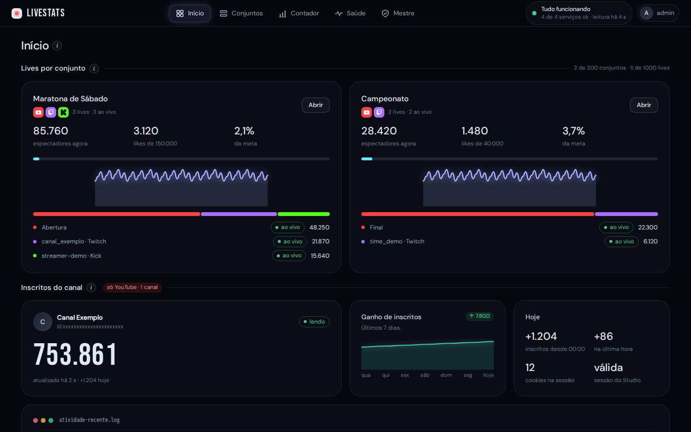

Resume tudo de uma vez: um cartão por conjunto (espectadores agora, likes contra a meta, mini gráfico e a lista de lives com o estado de cada uma), o contador de inscritos do canal e a atividade recente. Cada conjunto tem os seus próprios números; nada é somado entre conjuntos. Clique em **Abrir** para entrar no conjunto. No canto superior ficam o estado geral dos serviços e o menu da conta. Passe o mouse (ou toque) no ícone **ⓘ** ao lado dos títulos para ler a explicação de cada parte.

## Conjuntos e lives

A aba **Conjuntos** lista os seus conjuntos em cartões (plataformas, espectadores agora, meta e mini gráfico), com o botão **Novo conjunto**.

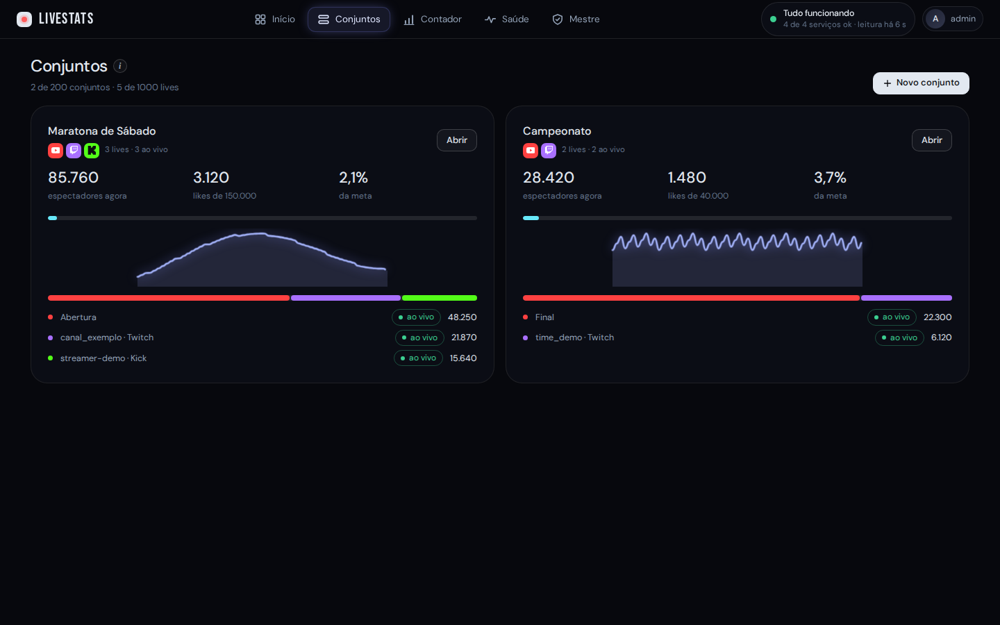

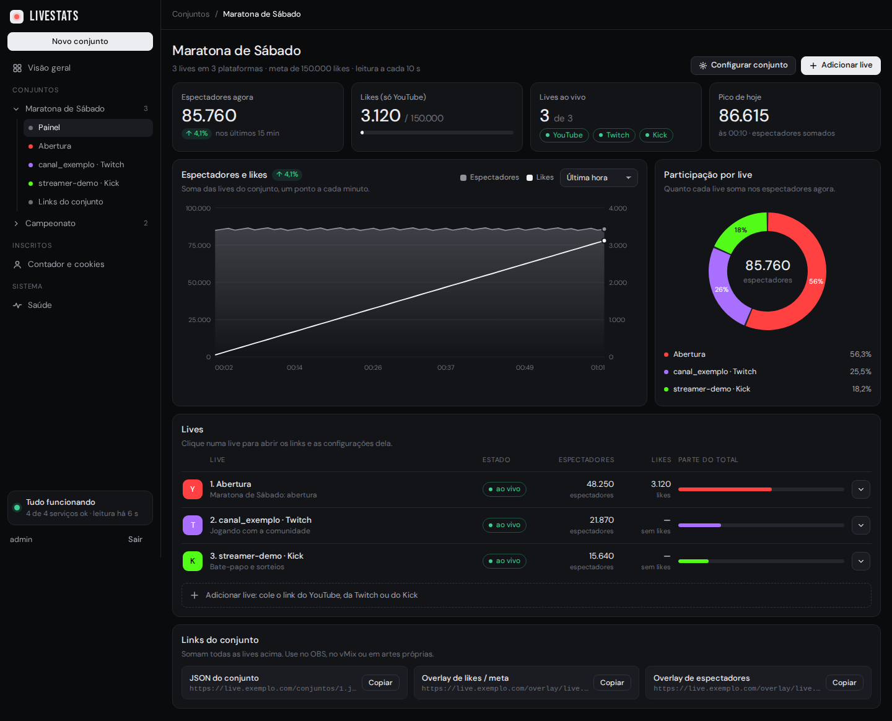

Um **conjunto** reúne lives de qualquer plataforma que você quer mostrar juntas, por exemplo todas as transmissões de um mesmo evento. A tela mostra:

- os totais (espectadores agora, likes contra a meta, lives ao vivo e o pico do dia);
- o **gráfico** de espectadores e likes, com período de 5 minutos a 2 horas (passe o mouse para ver os valores de cada minuto);
- a **rosca** com a participação de cada live nos espectadores;
- a lista de **lives** e os **links do conjunto**.

**Novo conjunto** cria um conjunto; dentro de um conjunto, o caminho **Conjuntos › Nome** no topo deixa pular direto para outro. **Configurar conjunto** edita o nome, a meta de likes, a fonte e a cor do texto; **Adicionar live** inclui uma transmissão.

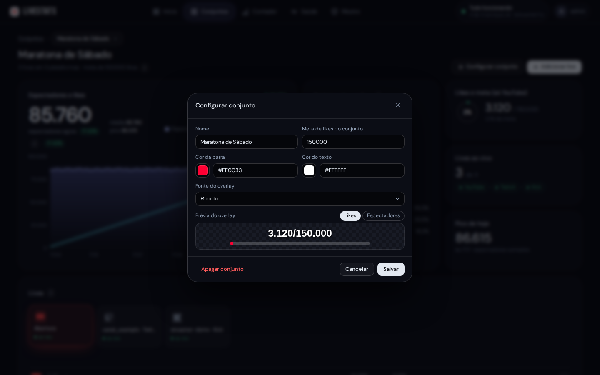

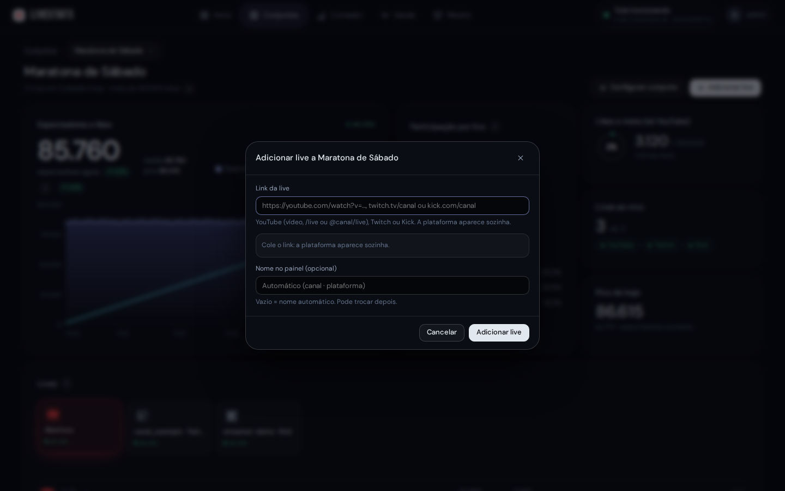

Para adicionar uma live, cole o link do YouTube (vídeo, ou canal como `youtube.com/@canal`, que acompanha sempre a live ativa do canal), da Twitch (`twitch.tv/canal`) ou do Kick (`kick.com/canal`); a plataforma aparece sozinha. O nome no painel é opcional. Se a transmissão ainda não começou, a live fica como "agendada" ou "offline" e passa a "ao vivo" sozinha.

## Links, cores e prévia de cada live

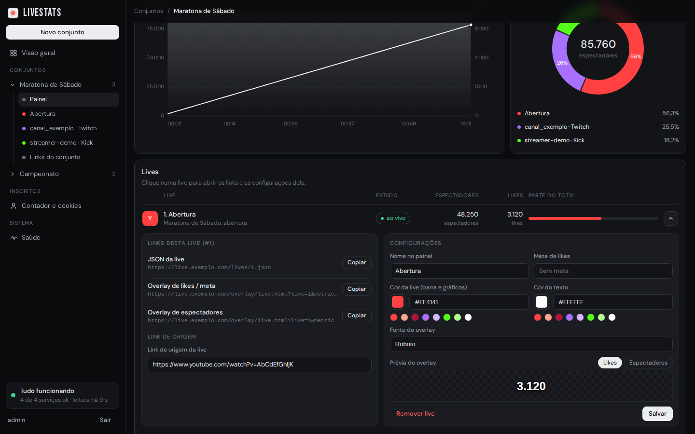

Clique numa live para abrir os **três links** dela, cada um com o botão **Copiar**:

- **JSON da live:** os dados dela para usar em artes e gráficos;
- **Overlay de likes / meta:** o número de likes (e a barra da meta, se houver);
- **Overlay de espectadores:** o número de espectadores agora.

Ao lado ficam as **configurações**: nome no painel, meta de likes, **cor da live** (usada na barra, no gráfico e na rosca), **cor do texto** e **fonte do overlay**. A **prévia** mostra na hora como o overlay vai ficar, para likes ou espectadores. **Salvar** grava; **Remover live** tira a live do conjunto. O rodapé do conjunto traz os mesmos três links para o conjunto inteiro (soma das lives).

Os links usam o endereço informado em `--public-base-url`. Sem ele, o painel mostra o endereço pelo qual você abriu a página.

## Chat do conjunto

No YouTube, a live pode ser cadastrada pelo link do canal (`@canal` ou `/channel/UC...`): o chat acompanha a live que estiver ativa e troca sozinho quando começar outra.

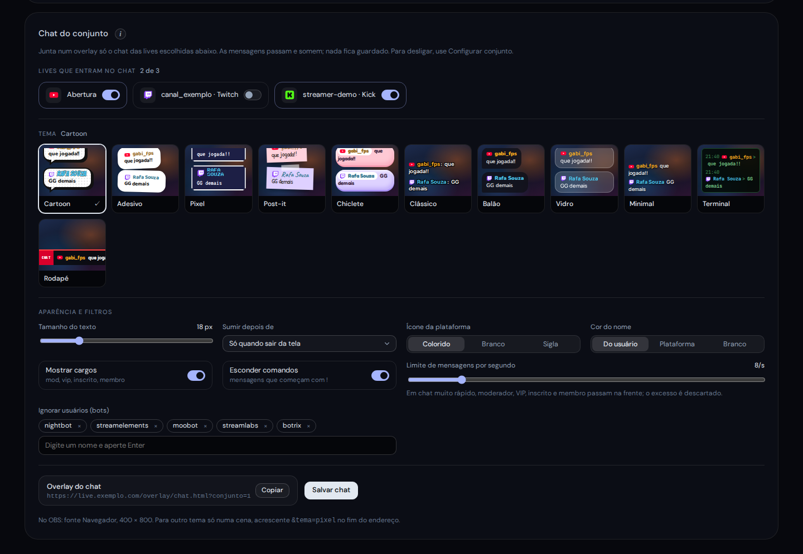

O chat unificado junta o chat das lives de um conjunto num overlay só, com o logo da plataforma ao lado do nome de quem escreveu.

1. Em **Configurar conjunto**, ligue **Chat do conjunto** e salve. Conjunto com o chat desligado não gasta nada de processamento.

   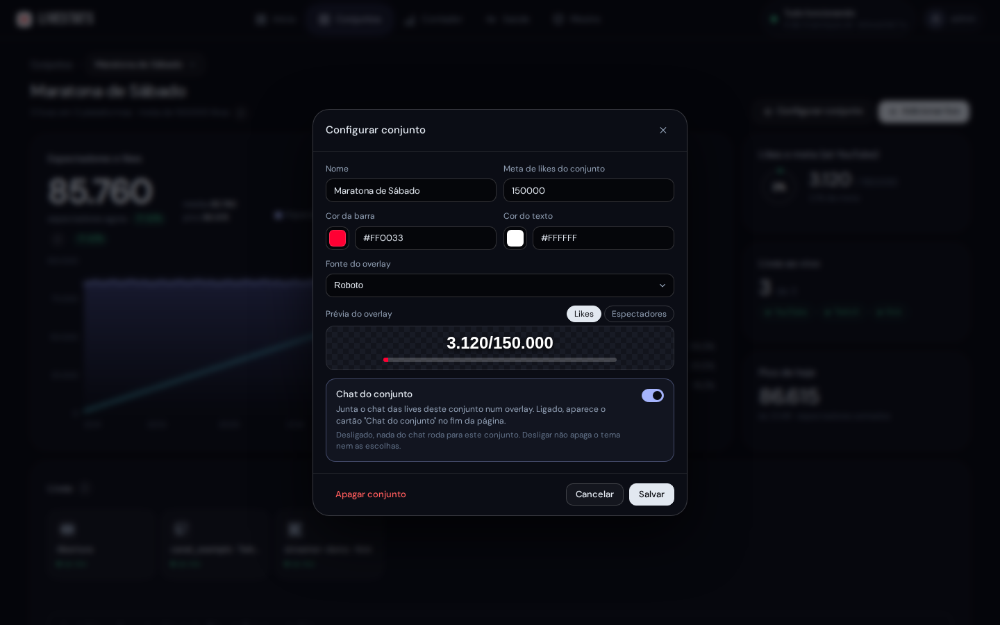

2. No fim da página do conjunto aparece o cartão **Chat do conjunto**. Ligue as lives que entram no chat, escolha o tema e ajuste a aparência: tamanho do texto, quanto tempo cada mensagem fica na tela (ou só até sair da tela), ícone da plataforma (colorido, branco ou sigla), cor do nome, cargos (moderador, VIP, inscrito, membro), esconder comandos que começam com `!`, limite de mensagens por segundo e bots ignorados. Clique em **Salvar chat**.
3. Copie o endereço do overlay e coloque no OBS ou no vMix (veja [Usar no OBS e no vMix](obs-e-vmix.md)).

O chat só é lido enquanto a live está **ao vivo** e o overlay está aberto em algum lugar. Nenhuma mensagem é guardada: ela aparece no overlay e some. Mensagens apagadas pela moderação somem do overlay também. Em chat muito rápido, o limite por segundo vale e moderadores, VIPs, inscritos e membros passam na frente.

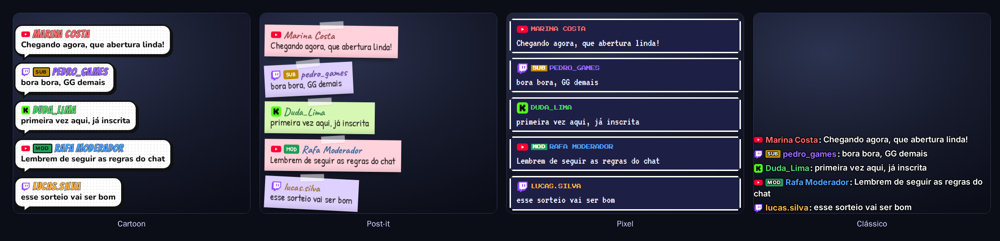

Temas: **Cartoon**, **Adesivo**, **Pixel**, **Post-it**, **Chiclete**, **Clássico**, **Balão**, **Vidro**, **Minimal**, **Terminal** e **Rodapé** (letreiro horizontal). Para usar outro tema só numa cena, acrescente `&tema=` ao endereço (por exemplo `&tema=pixel`).

## Contador de inscritos

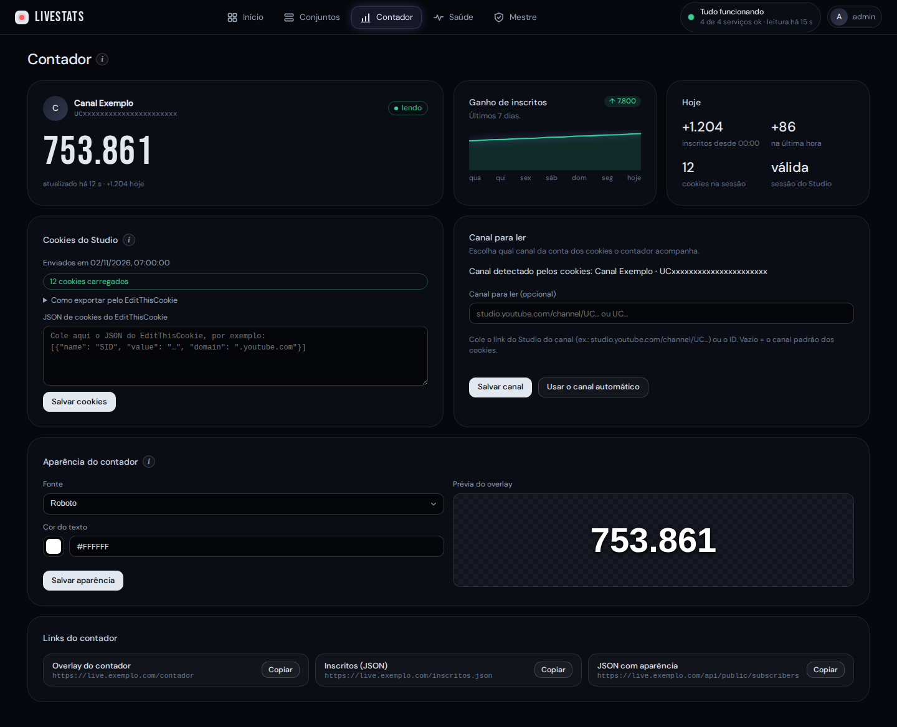

A aba **Contador** controla o contador de inscritos do canal do YouTube:

- o cartão do canal mostra o nome (descoberto sozinho pelos cookies), o número atual, o ganho dos últimos 7 dias e o de hoje;
- em **Cookies do Studio**, cole o JSON exportado do seu navegador (extensão EditThisCookie, logado no YouTube Studio do canal) e clique em **Salvar cookies**. Enquanto o serviço reabre a sessão do Studio, aparece o cartão **Conectando ao YouTube Studio…** (costuma levar menos de 1 minuto). Eles ficam cifrados e só o serviço que lê o contador consegue abri-los; o painel nunca os mostra de volta. Quando a sessão é renovada pelo próprio serviço, o painel avisa. Só YouTube, um canal;
- em **Canal para ler (opcional)**, escolha qual canal da conta o contador acompanha. Por padrão é o canal que o YouTube Studio abre sozinho com os seus cookies; se a conta tem mais de um canal (por exemplo um pessoal e outro da marca), cole o link do Studio do canal desejado (`studio.youtube.com/channel/UC...`) ou só o ID (`UC...`) e clique em **Salvar canal**. O painel mostra o canal que está sendo lido e o selo **canal escolhido**; **Usar o canal automático** volta ao padrão. A conta dos cookies precisa ter acesso ao canal: senão o contador mostra o erro "A conta dos cookies não tem acesso a este canal". Trocar de canal não apaga o histórico do canal anterior. Canais com menos de 10 inscritos ainda não aparecem (o formato público exige 2 dígitos ou mais);
- em **Aparência do contador**, escolha a fonte e a cor do texto, com prévia, e clique em **Salvar aparência**;
- os **links do contador** (overlay `/contador`, JSON de inscritos e JSON com a aparência) ficam no fim da tela, com **Copiar**.

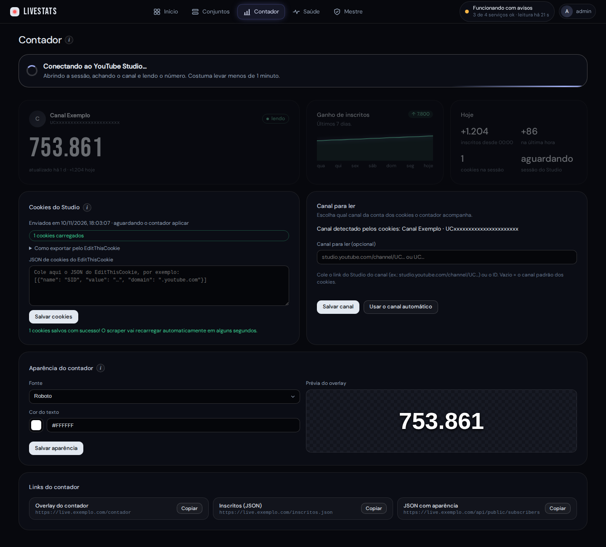

## Histórico e exportar PNG

O gráfico do conjunto guarda a live inteira: 12 horas de live, 12 horas para ver (faixa **Toda a live**). Nas últimas 24 h o histórico tem todos os pontos; depois vira um ponto por minuto, e sessões encerradas ficam por `HISTORY_RETENTION_DAYS` dias (padrão 14, no `.env`). Quando todas as lives estão fora do ar (depois de 10 min de folga) o gráfico para de contar e fica parado, com o aviso "parado desde HH:MM". O botão **Exportar PNG**, ao lado do seletor, baixa um período específico (De/Até, ou "Sessão inteira" e "Última hora") numa imagem 1600x800 no mesmo estilo do gráfico.

## Saúde

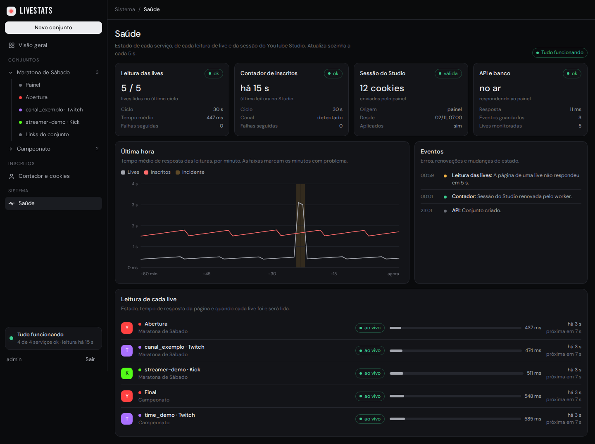

Mostra se está tudo funcionando: o estado de cada serviço (leitura das lives, contador de inscritos, sessão do Studio, API e banco), o tempo de resposta por minuto na última hora (as faixas marcam incidentes), os eventos recentes (erros, renovações de sessão) e a leitura de cada live, com o tempo de resposta e quando será a próxima. Atualiza sozinha.

## Conta

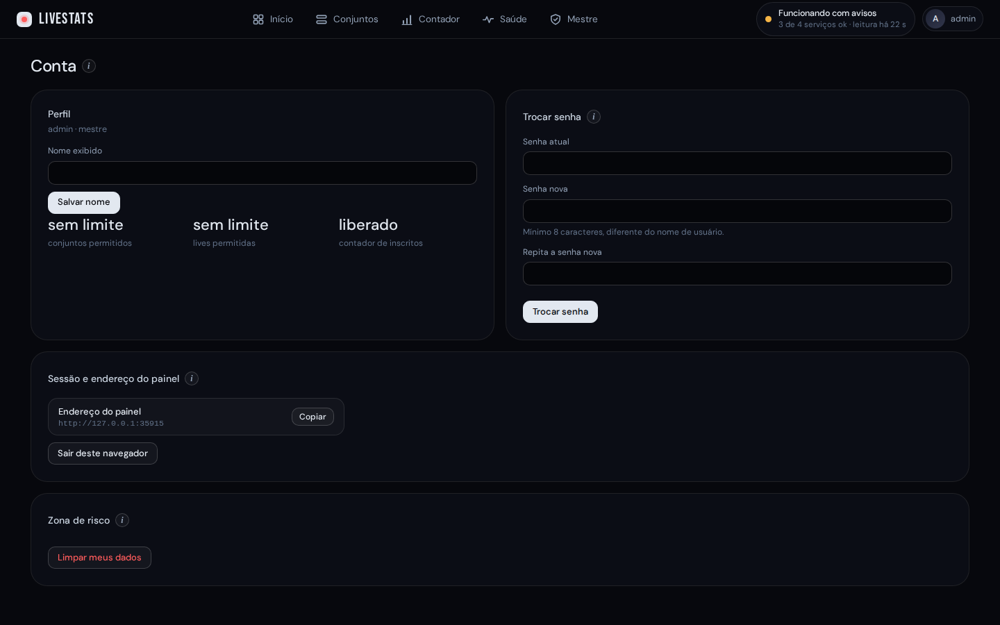

Nome, **trocar senha**, endereço externo do painel (se configurado), **Sair** e a **Zona de risco** com **Limpar meus dados**.

## No celular

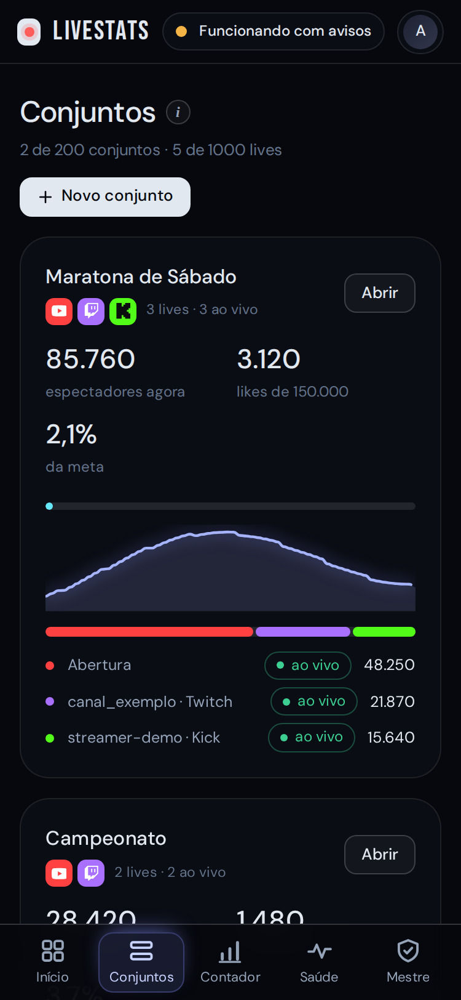

No celular, as abas ficam numa barra fixa embaixo da tela; no computador, no cabeçalho. Todas as telas funcionam no celular, desde que ele esteja na rede local, na VPN ou (com o acesso externo ligado) no endereço do painel.

---

[Início](../README.md) · [Instalação](instalacao.md) · [Primeiros passos](primeiros-passos.md) · **Painel** · [Usuários](usuarios.md) · [Acesso externo](acesso-externo.md) · [Endereços públicos](enderecos-publicos.md) · [OBS e vMix](obs-e-vmix.md) · [Manutenção](manutencao.md) · [Problemas comuns](problemas-comuns.md) · [Segurança](seguranca.md)
