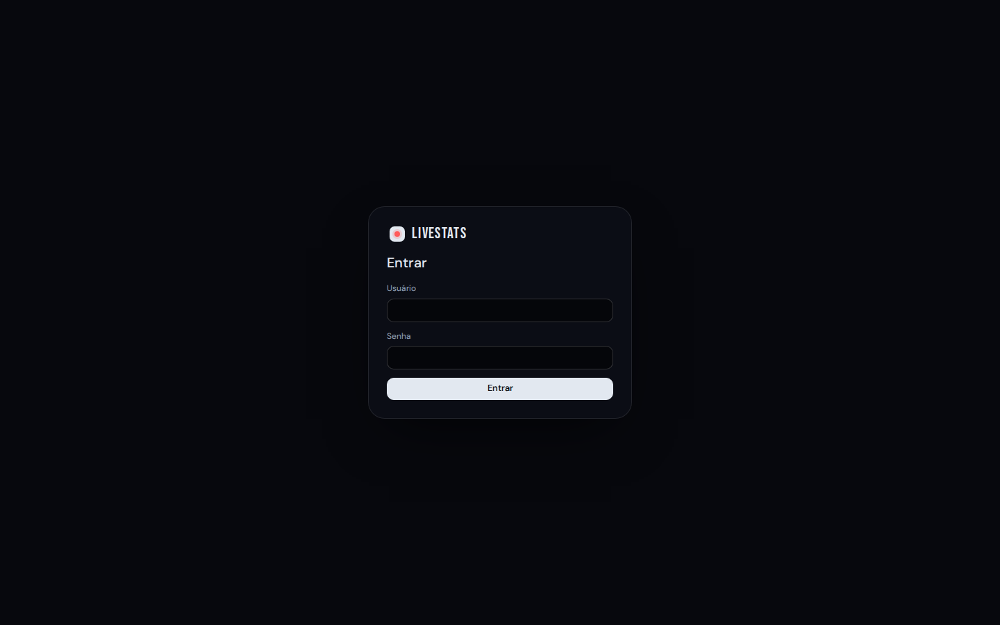
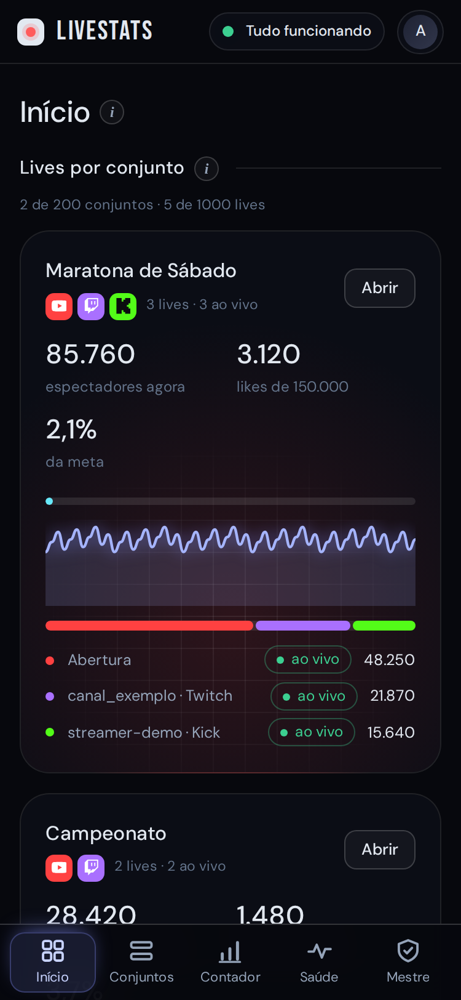

# Primeiros passos

[Início](../README.md) · [Instalação](instalacao.md) · **Primeiros passos** · [Painel](painel.md) · [Usuários](usuarios.md) · [Acesso externo](acesso-externo.md) · [Endereços públicos](enderecos-publicos.md) · [OBS e vMix](obs-e-vmix.md) · [Manutenção](manutencao.md) · [Problemas comuns](problemas-comuns.md) · [Segurança](seguranca.md)

## Primeiro acesso

1. Abra `https://IP-DO-SERVIDOR:8081` num computador da rede local (ou da VPN).
2. O navegador avisa que o certificado não é confiável: ele é autoassinado e gerado só para o seu servidor. Escolha **Avançado** e continue. Isso é pedido uma vez por navegador.
3. Entre com o usuário do painel e a senha que você digitou na instalação.

Depois do login, siga o tutorial abaixo: crie o primeiro conjunto, adicione as lives e, se for usar o contador, cole os cookies na aba **Contador**. No celular, as abas ficam numa barra fixa embaixo da tela.

## Tutorial: do zero ao OBS

Em dez minutos você tem uma live no ar dentro do OBS. Os nomes em **negrito** são botões e abas do painel.

1. **Crie um conjunto.** Aba **Conjuntos › Novo conjunto**. Dê um nome (por exemplo "Maratona de Sábado"), uma meta de likes (opcional) e escolha a fonte e a cor do texto dos overlays. Clique em **Salvar**.
2. **Adicione as lives.** Abra o conjunto e clique em **Adicionar live**. Cole o link da transmissão: YouTube (vídeo, ou canal como `youtube.com/@canal`, que acompanha sempre a live ativa do canal), Twitch (`twitch.tv/canal`) ou Kick (`kick.com/canal`). A plataforma é reconhecida sozinha. Se a live ainda não começou, ela fica "agendada" ou "offline" e passa a "ao vivo" sozinha.
3. **Confira os números.** Em alguns segundos o conjunto mostra espectadores agora, likes contra a meta, o gráfico e a rosca de participação.
4. **Copie o link do overlay.** Clique numa live (ou use os links do rodapé do conjunto, que somam todas) e use **Copiar** em *Overlay de likes / meta* ou *Overlay de espectadores*. Ajuste cor, fonte e meta na própria live e veja a **prévia**.
5. **Coloque no OBS.** Em **Fontes › + › Navegador**, cole o link, use a largura e a altura do seu layout e marque *Atualizar navegador quando a cena ficar ativa*. O fundo é transparente. Detalhes em [Usar no OBS e no vMix](obs-e-vmix.md).
6. **(Opcional) Ligue o contador de inscritos.** Aba **Contador**: logado no YouTube Studio do canal, exporte os cookies com o EditThisCookie, cole em **Cookies do Studio** e clique em **Salvar cookies**. Aparece o cartão **Conectando ao YouTube Studio…** (menos de 1 minuto) e depois o número. Se o canal que abriu não for o que você quer, preencha **Canal para ler** com o link do Studio ou o ID (`UC...`) e clique em **Salvar canal**. Depois copie o link do overlay do contador.
7. **(Opcional) Convide outras pessoas.** Quem administra cria as contas em **Mestre › Novo usuário** e passa a senha provisória; cada um faz o próprio passo a passo acima. Veja [Usuários e painel mestre](usuarios.md).

Se algo não funcionar, a aba **Saúde** (só do mestre) mostra o motivo, e a tabela [Problemas comuns](problemas-comuns.md) lista os casos mais frequentes.

---

[Início](../README.md) · [Instalação](instalacao.md) · **Primeiros passos** · [Painel](painel.md) · [Usuários](usuarios.md) · [Acesso externo](acesso-externo.md) · [Endereços públicos](enderecos-publicos.md) · [OBS e vMix](obs-e-vmix.md) · [Manutenção](manutencao.md) · [Problemas comuns](problemas-comuns.md) · [Segurança](seguranca.md)
