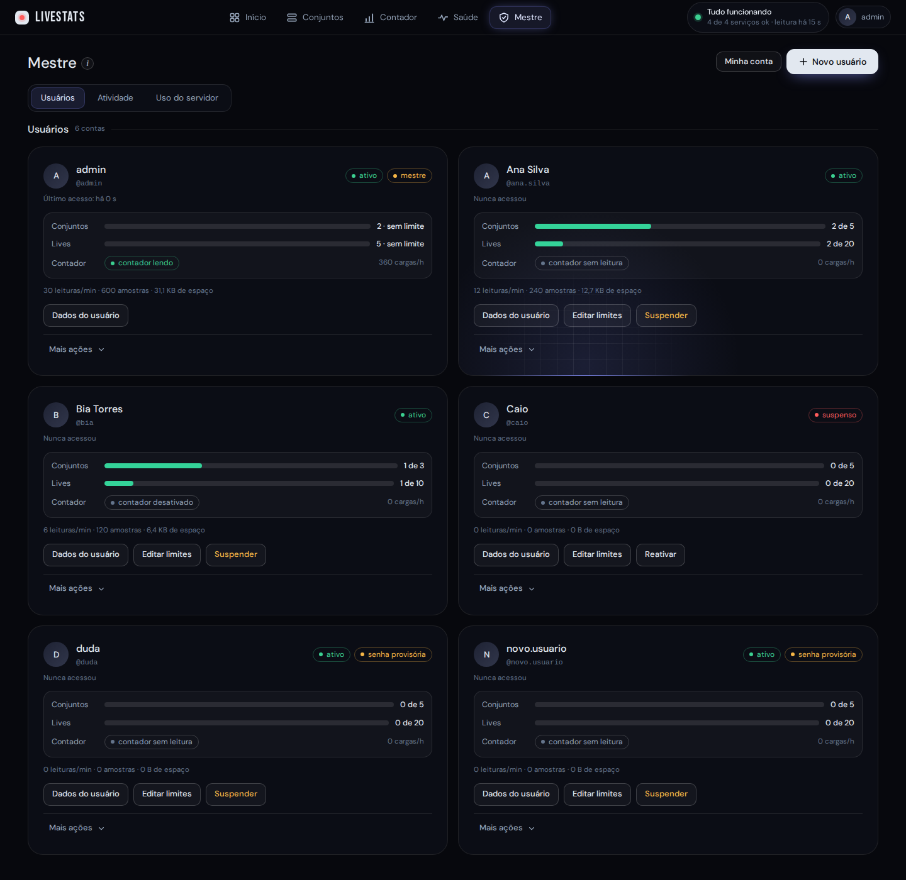
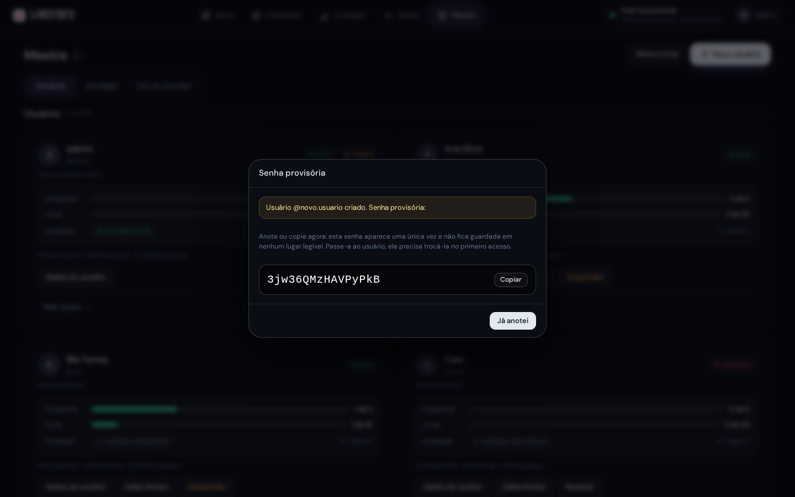
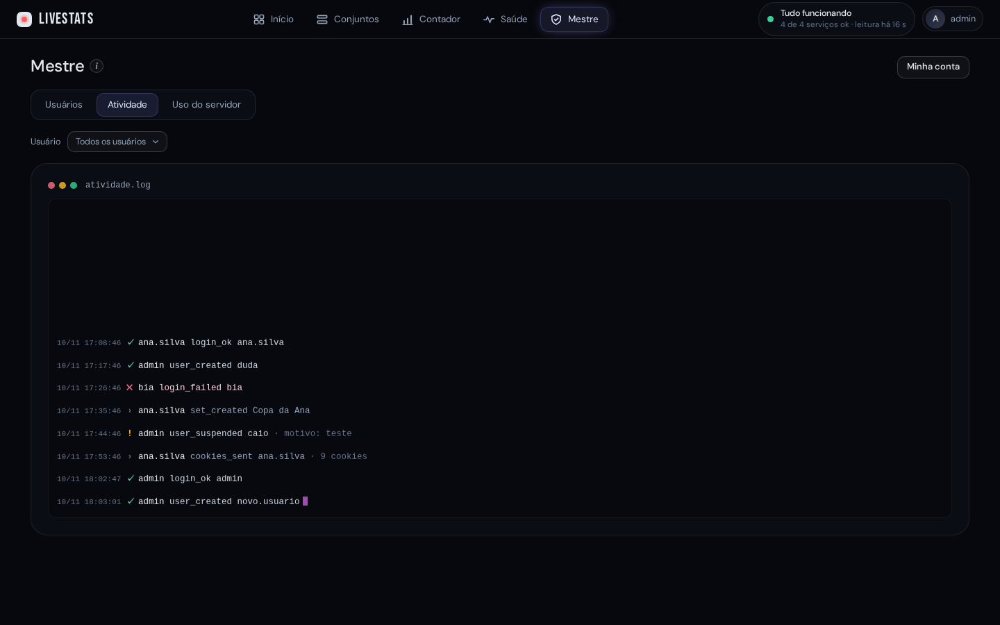

# Usuários e painel mestre

[Início](../README.md) · [Instalação](instalacao.md) · [Primeiros passos](primeiros-passos.md) · [Painel](painel.md) · **Usuários** · [Acesso externo](acesso-externo.md) · [Endereços públicos](enderecos-publicos.md) · [OBS e vMix](obs-e-vmix.md) · [Manutenção](manutencao.md) · [Problemas comuns](problemas-comuns.md) · [Segurança](seguranca.md)

O painel aceita vários usuários, cada um com seus próprios conjuntos, lives e contador de inscritos. Não existe cadastro aberto: só o **mestre** (o usuário criado na instalação) cria contas.

- **Criar um usuário:** no painel, aba **Mestre › Usuários**, **Novo usuário**. O LiveStats gera uma **senha provisória** de 16 caracteres, mostrada uma única vez (use **Copiar** e envie por um canal seguro). No primeiro acesso a pessoa é obrigada a trocar a senha (mínimo de 8 caracteres).

- **Limites por usuário:** quantidade de conjuntos e de lives e se ele tem contador de inscritos. Existe ainda um teto geral (`MAX_SETS_TOTAL`, padrão 200, e `MAX_LIVES_TOTAL`, padrão 1000, no `.env`).
- **Cada um enxerga só o que é seu.** O mestre vê o uso de cada conta, a atividade recente (entradas, trocas de senha, contas e conjuntos criados ou apagados), pode redefinir a senha, suspender, limpar os dados ou apagar a conta (digitando o nome dela para confirmar) e abrir os dados de qualquer usuário para editar. A tela **Saúde** é só do mestre.
A aba **Mestre** tem ainda **Atividade** (terminal com o que aconteceu, filtrável por usuário) e **Uso do servidor**.

- **Limpar meus dados:** na aba **Conta**, em **Zona de risco**, **Limpar meus dados** apaga os seus conjuntos, lives, contador, cookies e leituras (você digita o seu nome de usuário para confirmar). A conta, a senha e os limites continuam. O mestre pode fazer o mesmo com os próprios dados.
- **Contador por usuário:** cada conta com contador tem os próprios cookies do Studio, aparência e links. O do mestre continua em `/contador`, `/inscritos.json` e `/api/public/subscribers`; o dos outros usuários é lido por id (veja [Endereços públicos](enderecos-publicos.md)).
- **Restringir o mestre:** com `MASTER_ALLOW_CIDRS` no `.env` (ou `--master-allow` no `instalar`), o login do mestre e as telas do mestre só funcionam a partir dessas redes.

---

[Início](../README.md) · [Instalação](instalacao.md) · [Primeiros passos](primeiros-passos.md) · [Painel](painel.md) · **Usuários** · [Acesso externo](acesso-externo.md) · [Endereços públicos](enderecos-publicos.md) · [OBS e vMix](obs-e-vmix.md) · [Manutenção](manutencao.md) · [Problemas comuns](problemas-comuns.md) · [Segurança](seguranca.md)
